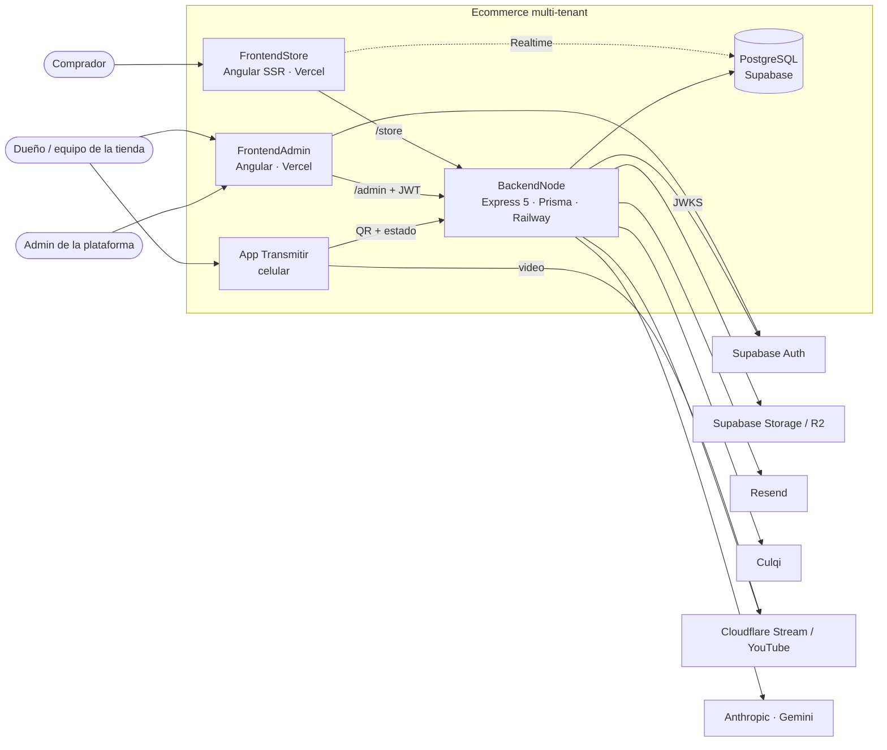
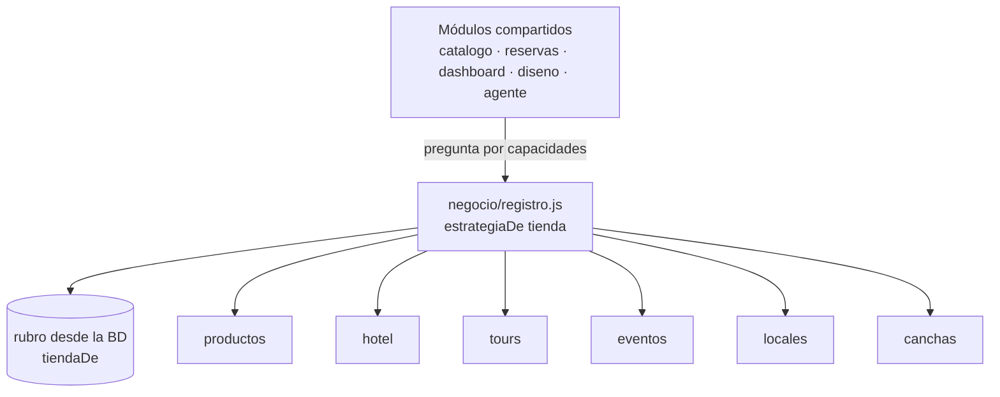

# Arquitectura en diagramas

Los diagramas se escriben como texto: viven con el código, se revisan en cada commit y GitHub los muestra.
Las convenciones de código siguen en [`docs/ARQUITECTURA.md`](../ARQUITECTURA.md).

| Qué | Herramienta | Dónde se ve |
|---|---|---|
| Vista rápida (abajo) | Mermaid | Aquí mismo, en GitHub |
| Modelo completo, con vistas navegables | LikeC4 ([`modelo.c4`](modelo.c4)) | Sitio que genera la Action `arquitectura`, o en local |
| Flujos de una funcionalidad (secuencias, estados) | Mermaid | En su `docs/specs/<feature>/` |

## Contexto y contenedores

## Lógica por rubro

## Ver el modelo LikeC4

- **En local:** `npx likec4 start docs/arquitectura` abre el sitio con todas las vistas (contexto, contenedores, backend, rubros).
- **Validar:** `npx likec4 validate docs/arquitectura` (lo corre también la Action en cada push).
- **En GitHub:** la Action `.github/workflows/arquitectura.yml` arma el sitio y lo deja como artefacto descargable del run.
  Para publicarlo en GitHub Pages, ver el comentario al final de la Action (repo privado: requiere plan Pro o Team).
- **Editor:** la extensión "LikeC4" de VS Code muestra la vista previa y autocompleta.

## Cómo se mantiene

- Módulo, servicio externo o relación nueva: se agrega una vez en `modelo.c4` y aparece en todas las vistas.
- Rubro nuevo: va dentro de `negocio` en `modelo.c4`, igual que en el código.
